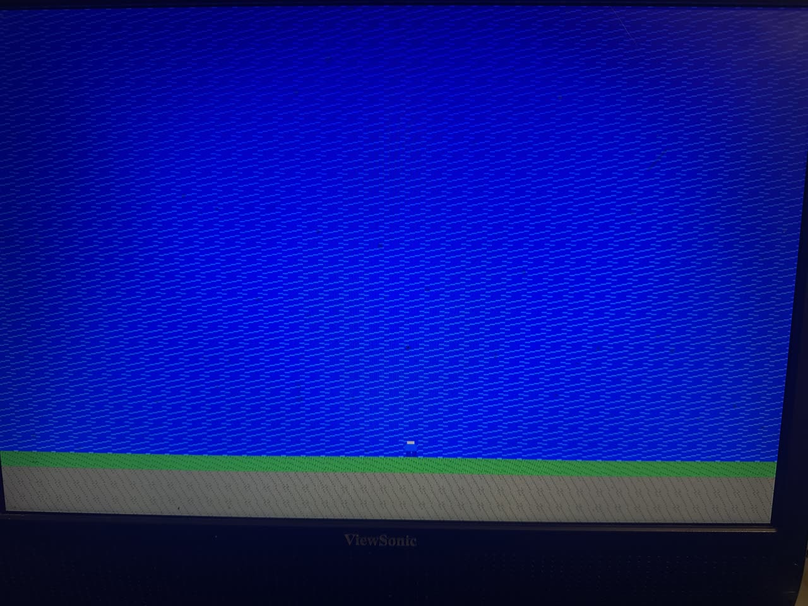
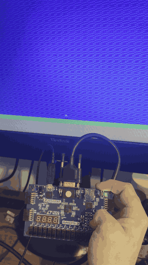

# FPGA VGA Tile Renderer

A tile-based 2D game renderer for the Digilent Basys 3 (Artix-7) FPGA. It draws a 640×480 @ 60 Hz VGA picture from a tilemap and a set of 16×16 tiles, and puts a player sprite on top that you can walk and jump with the board's buttons.

This is the start of a sidescroller. **Scrolling isn't supported yet.** The level is a single fixed screen.

The design mixes VHDL (top level and reused building blocks like flip-flops and debouncing) and SystemVerilog (the video pipeline and game logic).



## Demo



Walking and jumping with the Basys 3 buttons.

## Features

- 640×480 @ 60 Hz VGA output from a 25.175 MHz pixel clock
- 40×30 tilemap of 16×16 tiles, with 8 tiles and 12-bit color (4 bits per channel)
- 16×16 player sprite with transparency (magenta `F0F` is see-through)
- Walking and jumping with gravity, updated once per frame
- Debounced button inputs

## Hardware

- Digilent Basys 3 (`xc7a35tcpg236-1`)
- VGA monitor and cable
- Vivado 2024.2 (other versions may need the clock IP upgraded)

## Controls

| Button | Action |
|---|---|
| BTNL (left) | Walk left |
| BTNR (right) | Walk right |
| BTNC (center) | Jump |
| BTND (bottom) | Reset |

## Building

1. Open `vivado_project/vivado_project.xpr` in Vivado.
2. Run **Generate Bitstream**.
3. Open **Hardware Manager**, connect to the Basys 3, and program it with `Tile_Generator_TopLevel.bit`.
4. Plug in a VGA monitor.

## How it works

```
CLK (100 MHz) → clk_wiz_0 → 25.175 MHz pixel clock
                               │
              hcounter / vcounter  (pixel position Hcnt, Vcnt)
                │          │
            syncgen    tile_fetch ── map_rom (tilemap.mem) → tile_rom (tile_data.mem)
         Hsync/Vsync       │
                       sprite_fetch ── sprite_rom (sprite_data.mem)
                           │           ▲
                           │      player_control (buttons → sprite_x, sprite_y)
                           ▼
                        imagegen → vgaRed / vgaGreen / vgaBlue
```

1. **Timing:** `hcounter` and `vcounter` count through each 800×525 frame. `syncgen` makes the Hsync/Vsync pulses and a `video_active` flag for the visible 640×480 area.
2. **Background:** `tile_fetch` turns the pixel position into a tile row and column. It looks up which tile goes there in `map_rom`, then the pixel's color in `tile_rom`. This takes 2 clock cycles, so `video_active` is delayed 2 cycles to match.
3. **Sprite:** `sprite_fetch` checks whether the pixel is inside the player's 16×16 box and reads its color from `sprite_rom`. It has the same 2-cycle delay so it lines up with the background.
4. **Output:** `imagegen` shows the sprite color where the sprite isn't transparent, the background color everywhere else, and black during blanking.
5. **Player:** `player_control` reads the debounced buttons and moves the sprite once per frame. It applies gravity while the player is in the air and stops them at the ground height (`GROUND_Y`).

## Editing the level and graphics

The ROM contents come from three hex files in `vivado_project/vivado_project.srcs/sources_1/new/`, with one value per line:

| File | Contents | Layout |
|---|---|---|
| `tilemap.mem` | 1200 tile IDs (0–7) | 30 rows × 40 columns, row by row from the top left |
| `tile_data.mem` | 2048 colors | 8 tiles × 256 pixels; each tile is 16 rows of 16 pixels |
| `sprite_data.mem` | 256 colors | 16 rows of 16 pixels; `F0F` is transparent |

Colors are 3 hex digits: red, green, blue (for example `F00` is red).

Current tiles:

| ID | Tile |
|---|---|
| 0 | Grass |
| 1 | Brick |
| 2 | Blue with light streaks (used as sky) |
| 3 | Dirt |
| 4–7 | Solid colors (placeholders) |

The current level is sky in rows 0–25, grass in row 26 and dirt in rows 27–29. The player doesn't collide with tiles yet; they stand at a fixed height set by `GROUND_ROW` in `player_control.sv`. If you move the ground in `tilemap.mem`, update `GROUND_ROW` to match.

## Simulation

Testbenches are in `vivado_project/vivado_project.srcs/sim_1/new/` and `sim/`:

| Testbench | Checks |
|---|---|
| `tb_VGA_Timing` | Sync timing over 2 frames |
| `tb_map_rom` | Tilemap contents and read delay |
| `tb_tile_rom` | Tile pixel data |
| `tb_tile_fetch` | Background pipeline alignment |
| `tb_sprite_fetch` | Sprite position and transparency |
| `tb_player_control` | Walking, jumping and landing |

To run one, set it as the simulation top in Vivado and run **Run Behavioral Simulation**. Type `run all` in the Tcl console, because Vivado stops after 1000 ns by default. `tb_player_control` simulates millions of cycles to get past the button debounce, so it takes a little while.

## Roadmap

- [ ] Horizontal scrolling (a camera offset added to `Hcnt` before the tile lookup, and a tilemap wider than the screen)
- [ ] Collision between the player and solid tiles
- [ ] More tiles and a proper sky tile

## Project structure

```
constraints/basys3.xdc        Pin assignments for the Basys 3
src/                          VHDL top level and reused modules (DFF, Debounce, PulseGenerator, Mux2to1)
vivado_project/
  vivado_project.xpr          Vivado project
  vivado_project.srcs/
    sources_1/new/            SystemVerilog modules and .mem files
    sim_1/new/                Testbenches
docs/                         Development notes
  media/                      Screenshot and demo GIF for this README
```

## License

MIT. See [LICENSE](LICENSE).
